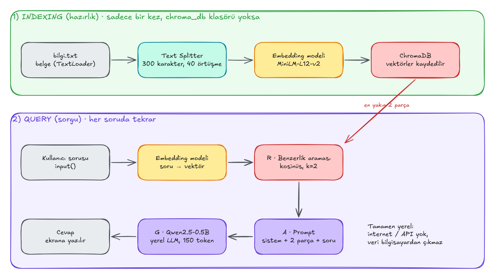

# Local RAG Project

Yerel bir metin/PDF dokümanı üzerinde soru-cevap yapan, **tamamen kendi bilgisayarında çalışan** basit bir RAG (Retrieval-Augmented Generation) uygulaması. Doküman ve sorular harici bir API'ye gönderilmez; embedding modeli ve dil modeli Hugging Face `transformers` / `sentence-transformers` ile yerelde çalışır.

> Modeller ilk çalıştırmada Hugging Face'ten bir kez indirilir (internet gerekir). Sonraki çalıştırmalarda bilgisayardaki önbellekten yüklenir.

## Mimari Akış



Şema iki aşamadan oluşur:
- **Indexing (hazırlık):** Doküman bir kez işlenip vektör veritabanına kaydedilir. `chroma_db` klasörü varsa bu aşama atlanır.
- **Query (sorgu):** Her soruda tekrar çalışır: soru vektöre çevrilir, en yakın parçalar bulunur (**R**), soruyla birlikte prompt'a eklenir (**A**) ve dil modeli cevabı üretir (**G**).

> Şemanın düzenlenebilir hali: [`docs/mimari.excalidraw`](docs/mimari.excalidraw) ([excalidraw.com](https://excalidraw.com) üzerinde açılabilir).

```
load → chunk → embed → ChromaDB → retrieve → generate
```

1. **Load:** `bilgi.txt` dosyası `TextLoader` ile (PDF ise `PyPDFLoader` ile) okunur.
2. **Chunk:** Metin `RecursiveCharacterTextSplitter` ile küçük parçalara bölünür.
3. **Embed:** Her parça embedding modeliyle vektöre çevrilir.
4. **ChromaDB:** Vektörler `./chroma_db` klasöründe saklanır. Klasör zaten varsa doküman tekrar işlenmez, mevcut veritabanı yüklenir.
5. **Retrieve:** Kullanıcının sorusuna anlamca en yakın parçalar ChromaDB'den getirilir.
6. **Generate:** Bulunan parçalar soruyla birlikte prompt'a eklenir ve yerel dil modeli cevabı üretir.

Program başında veritabanı ve dil modeli **bir kez** yüklenir; ardından kullanıcıdan döngü içinde soru alınır (`q` ile çıkılır).

## Kullanılan Modeller

| Görev | Model |
|---|---|
| Embedding | `sentence-transformers/paraphrase-multilingual-MiniLM-L12-v2` |
| Metin üretimi (LLM) | `Qwen/Qwen2.5-0.5B-Instruct` |

Doküman Türkçe olduğu için, yalnızca İngilizce için eğitilmiş `all-MiniLM-L6-v2` yerine Türkçe dahil 50+ dili destekleyen çok dilli bir embedding modeli kullanılıyor.

## Ayarlar (`main.py` içinde)

| Ayar | Değer | Anlamı |
|---|---|---|
| `chunk_size` | 300 | Bir parçanın en fazla karakter sayısı |
| `chunk_overlap` | 40 | Ardışık parçalar arasındaki ortak karakter sayısı |
| `k` | 2 | Her soru için getirilen parça sayısı |
| `max_new_tokens` | 150 | Modelin üretebileceği en fazla yeni token sayısı |
| `persist_directory` | `./chroma_db` | Vektör veritabanının saklandığı klasör |

## Dosyalar

```
local-rag-project/
├── main.py           # Uygulamanın tüm kodu
├── bilgi.txt         # Örnek doküman (sorgulanan metin)
├── requirements.txt  # Python bağımlılıkları
├── docs/             # Mimari şeması (PNG + düzenlenebilir .excalidraw)
├── .gitignore
└── README.md
```

## Kurulum ve Çalıştırma

```bash
git clone https://github.com/enesylvcl/local-rag-project.git
cd local-rag-project

# (İsteğe bağlı) sanal ortam
python -m venv .venv
# Windows: .venv\Scripts\activate   |   Linux/macOS: source .venv/bin/activate

pip install -r requirements.txt

python main.py
```

Örnek kullanım:

```
Sorunuzu yazın (çıkmak için 'q'): Proje teslimi için neler gereklidir?
```

> `bilgi.txt` içeriğini veya embedding modelini değiştirirsen `chroma_db` klasörünü sil; program bir sonraki çalıştırmada veritabanını yeniden oluşturur.
